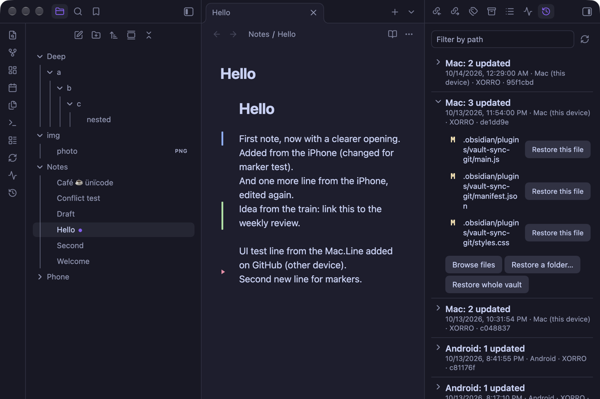
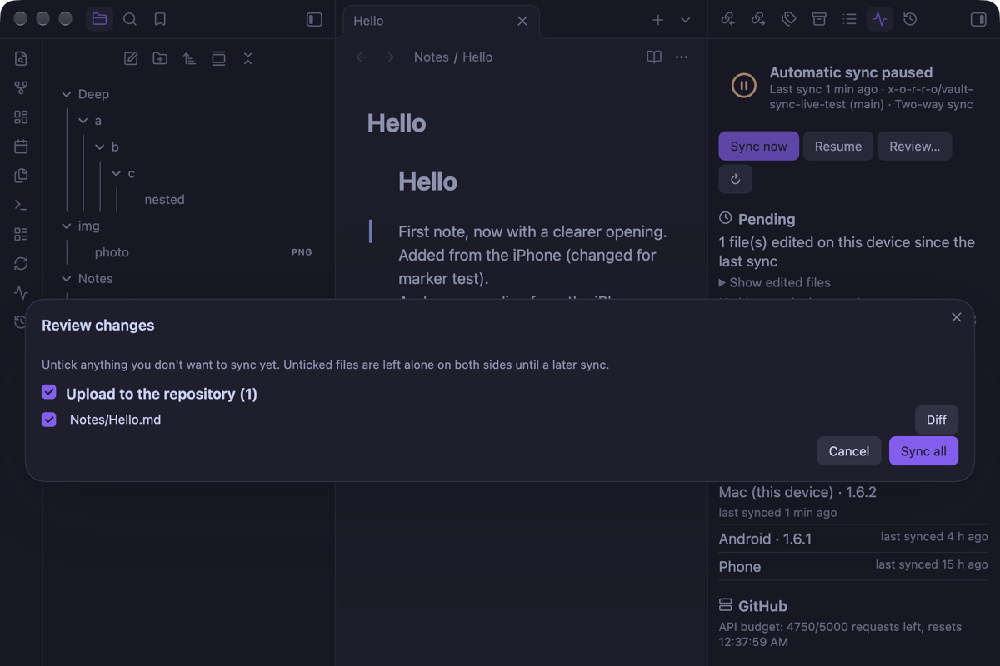
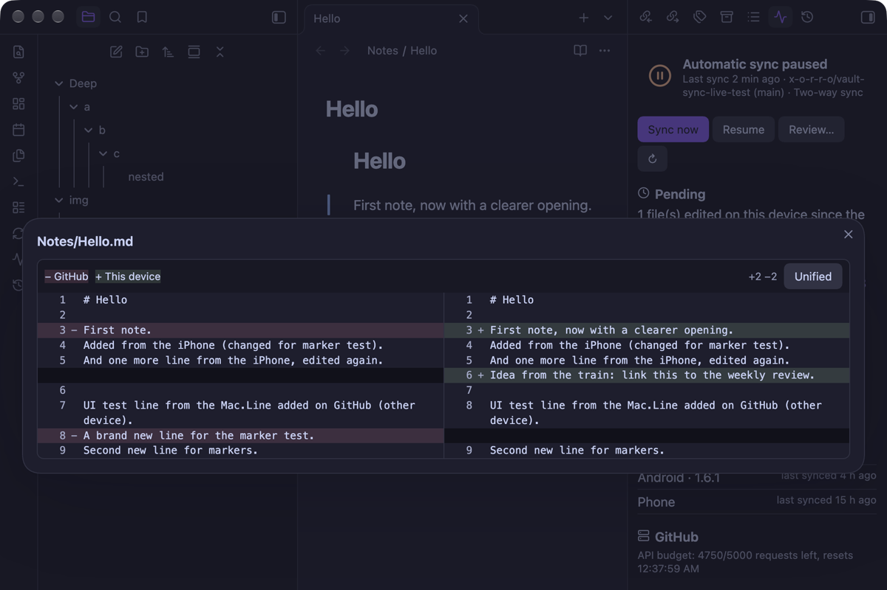
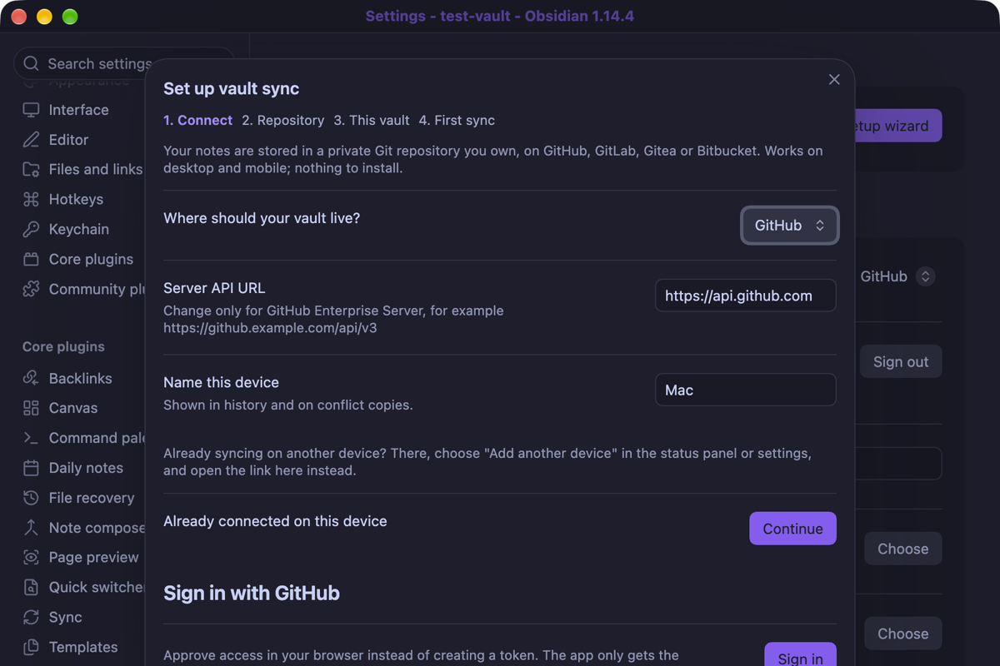
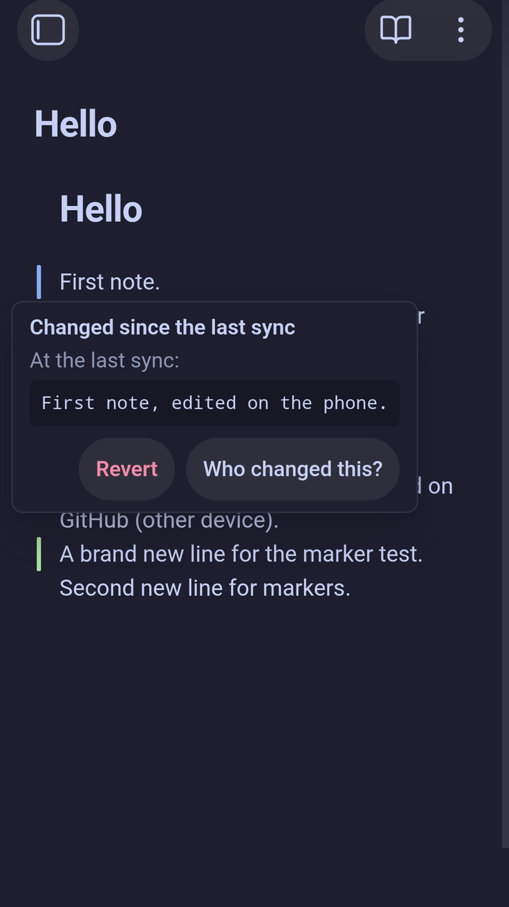
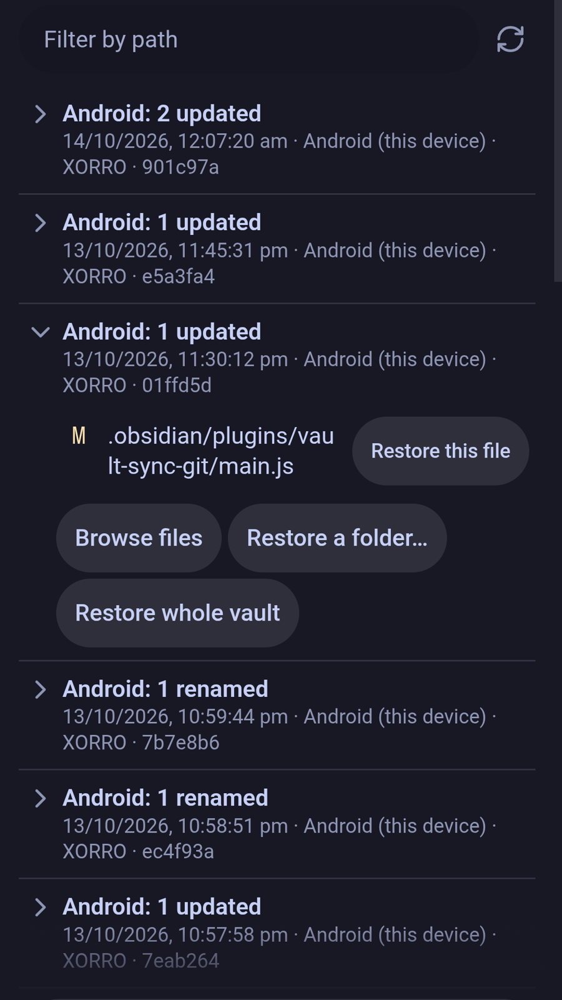
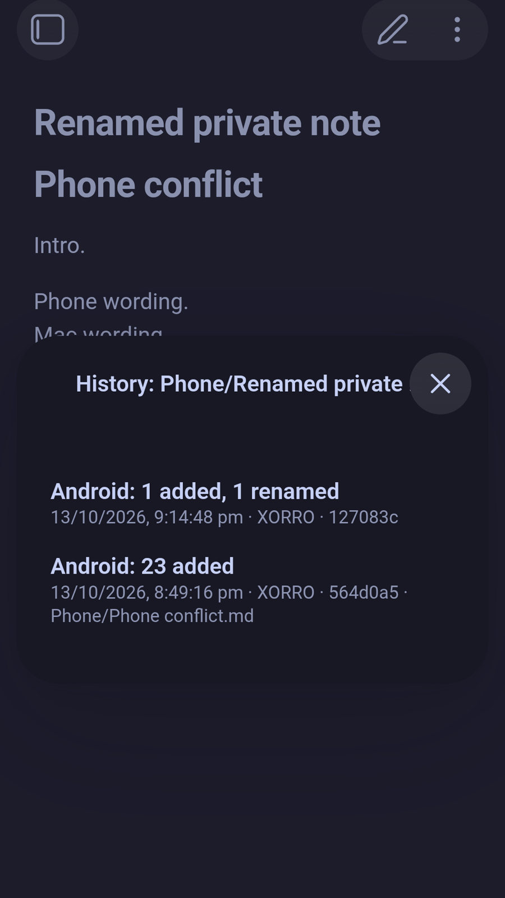
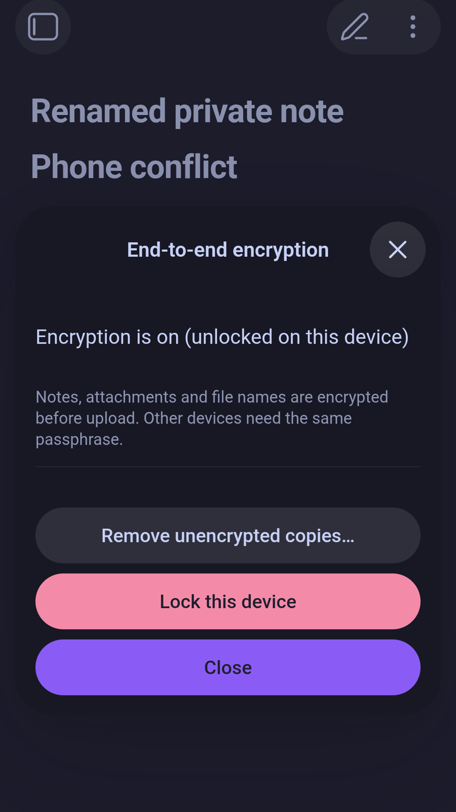
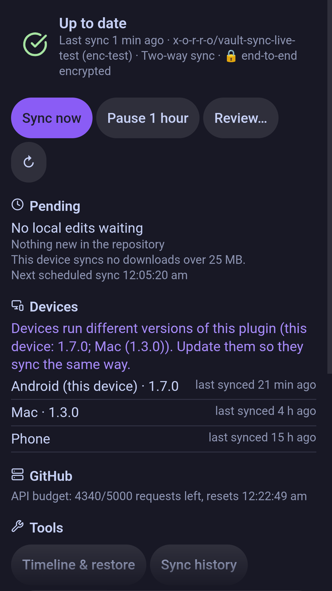

# Vault Sync for Git

**Sync and back up your Obsidian vault with a Git repository on GitHub, GitLab, Codeberg, Gitea, Forgejo or Bitbucket.** It works the same on desktop and mobile (Windows, macOS, Linux, iOS, Android), and you don't need to install Git.

Your vault lives in a repository you own, on the host you choose. Every device syncs through that repository, which also keeps a full history of every change. You can switch hosts at any time in the setup wizard or settings.

| Host | Status | Notes |
|---|---|---|
| **GitHub** (github.com and GitHub Enterprise) | Stable | Every sync is one atomic commit with fast-forward-only updates. |
| **GitLab** (gitlab.com and self-managed) | Beta, live-tested | Atomic multi-file commits with per-file locking. |
| **Gitea / Forgejo** (including **Codeberg** and self-hosted servers) | Beta, live-tested | Atomic multi-file commits with per-file locking. Needs Gitea or Forgejo 1.20+. |
| **Bitbucket Cloud** | Beta, live-tested | Multi-file commits checked against the expected parent. The first sync downloads each file once to index it. |

*Live-tested* means the full sync test suite passed against the real gitlab.com, codeberg.org and bitbucket.org.

## Highlights

- **No Git install.** No `git` binary and no `.git` folder: the plugin talks to your host's API, so it works the same on every device.
- **Real merging.** Edits from two devices are merged line by line; canvases and frontmatter merge by structure. When the same lines change, both versions are kept, or you pick change by change.
- **Safe by default.** Edits win over deletions, deleted files go to the trash, a delete guard stops mass deletions, a note you're editing is never overwritten, and you're warned when another sync tool runs on the same vault.
- **Backups and history.** Every sync is one commit. Restore a file, a folder or the whole vault to any earlier point, recover deleted files, and follow a note's history back through renames.
- **See before you sync.** Changed lines are marked in the editor, with one-click revert and *who last changed this line*. Review pending changes with diffs, and check everything in a status panel.
- **Private by design.** Optional end-to-end encryption: the host only stores unreadable data, including file names. Sign in with GitHub or GitLab instead of pasting a token.
- **Fits every device.** Sync only some folders on a phone, keep big attachments in the repository until you need them, add a new device with a QR code, share a folder with a team, mirror to a second host, and use it in 8 languages.

## Screenshots

On a desktop:

| | |
|---|---|
|  |  |
|  |  |

On a phone (Android, end-to-end encrypted vault):

| Changes since the last sync | Sync history | History across renames | Encryption | Sync status |
|---|---|---|---|---|
|  |  |  |  |  |

## Install

- **Community plugins:** in Obsidian, open Settings → Community plugins → Browse, search for **Vault Sync for Git**, then install and enable it.
- **Manual:** download `main.js`, `manifest.json` and `styles.css` from the latest [release](../../releases) into `<vault>/.obsidian/plugins/vault-sync-git/`, then enable the plugin under Community plugins.
- **BRAT:** add this repository in the BRAT plugin to get new releases on each device.

## Quick start

1. Install and enable the plugin. The **setup wizard** opens.
2. Choose your host and **Sign in** (GitHub or GitLab), or paste an access token.
3. Pick or create a **private** repository.
4. Choose whether this device uploads, downloads or merges, and run the first sync.
5. On your other devices, use **Add another device** (QR code or link), or run the wizard with the same repository.

The first sync never deletes anything: if a file differs, both versions are kept. Details for every host and for tokens are in [Setup](docs/SETUP.md).

## Documentation

- [Setup](docs/SETUP.md): sign-in, access tokens for each host, adding devices
- [Features and commands](docs/FEATURES.md): everything the plugin does, and every command
- [Security](docs/SECURITY.md): tokens, encryption limits, data-safety guarantees
- [Hosts and limits](docs/LIMITS.md): notes per host, file sizes and known limits
- [Changelog](CHANGELOG.md) · [Roadmap](docs/ROADMAP.md) · [Comparison with other sync plugins](docs/RESEARCH.md) · [Contributing](CONTRIBUTING.md)

## Requirements

- Obsidian 1.11.4 or newer, on desktop (Windows, macOS, Linux) or mobile (iOS, Android).
- An account with a supported Git host.

## Network use, accounts and privacy

This section covers the disclosures Obsidian's developer policies require.

- **Account required.** You need an account with a Git host (GitHub, GitLab, Bitbucket, or a Gitea / Forgejo / Codeberg server) and an access token (or Sign in with GitHub or GitLab). The plugin itself is free; no payment.
- **Network use.** The plugin only connects to the Git host **you configure**, to read and write your repository:
  - `api.github.com` (or your GitHub Enterprise server), `gitlab.com` (or your GitLab server), your Gitea / Forgejo / Codeberg server, or `api.bitbucket.org`
  - the backup mirror's host, if you set up a mirror
  - with *Install plugin code from official releases* on: `raw.githubusercontent.com` (Obsidian's community plugin list, read only when a plugin turned on elsewhere is missing or outdated here) and `github.com` (the plugin's release files, only after you confirm an install, which GitHub serves from its file storage, `*.githubusercontent.com`)
  - with Sign in with GitHub, also `github.com/login/device/code` and `github.com/login/oauth/access_token` to sign in and renew access
  - with Sign in with GitLab, also `/oauth/authorize_device` and `/oauth/token` on `gitlab.com` (or your GitLab server) to sign in and renew access
  - the same host's Git LFS endpoint, if you turn on large file storage
  - for Git LFS on any host, the file-storage address the LFS server returns for each upload or download
- **No telemetry, no ads, no third-party services.** Nothing is sent anywhere except the hosts listed above. The author runs no servers.
- **Files.** The plugin lists and reads the files in your vault to sync them, and writes only inside your vault, including the vault's settings folder if you turn on settings sync. It keeps its own state in its plugin folder.
- **Your data stays in your repository.** With end-to-end encryption on, the host only stores encrypted content and encrypted file names.

## License

[MIT](LICENSE). Bundled third-party code (the QR code generator) is listed in [THIRD_PARTY_NOTICES.md](THIRD_PARTY_NOTICES.md).
